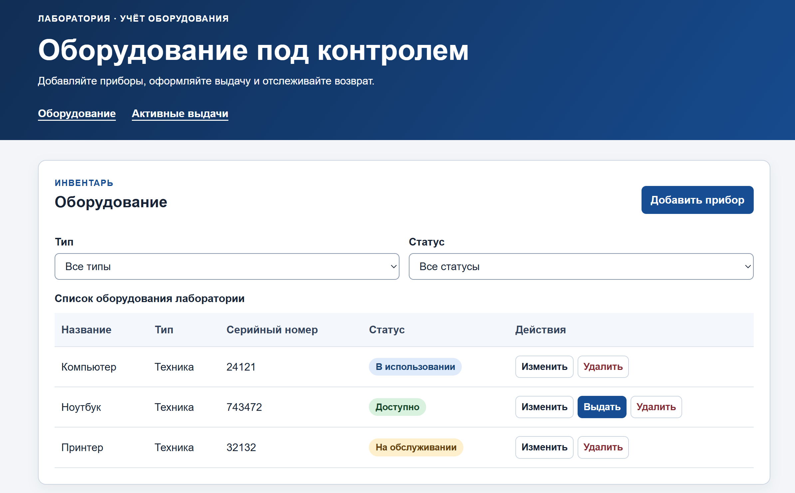
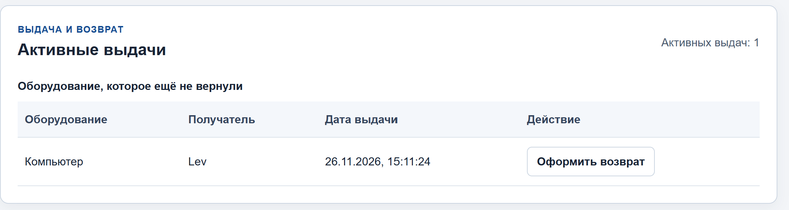
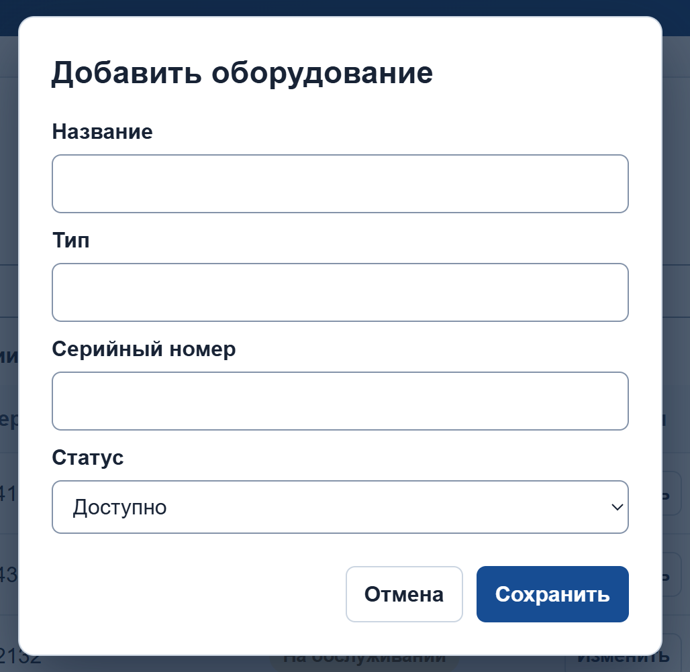

# Лабораторная работа №8. Система учёта оборудования

Веб-приложение для лаборатории. Оборудование можно добавлять, просматривать, изменять и удалять. Приборы можно выдавать сотрудникам и оформлять их возврат. В таблице виден статус «В использовании», есть фильтры по типу и статусу, а отдельный раздел показывает активные выдачи.

Сервер написан на Java и Spring Boot, данные хранятся в SQLite. Интерфейс состоит из HTML, CSS и JavaScript. Spring Boot отдаёт страницу из `src/main/resources/static/index.html`, а JavaScript отправляет запросы к API. Express заменён на Spring Boot по согласованию языка бэкенда.

## Запуск

Нужны JDK 21 и Maven. Откройте папку проекта в IntelliJ IDEA как Maven-проект и запустите класс `Lab8Application`. Или из корня проекта выполните `mvn spring-boot:run`. Затем откройте `http://localhost:8080/`.

При первом запуске создаются папка `data`, файл `data/equipment.db` и таблицы `equipment`, `loans`. Файл базы данных хранится только на вашем компьютере и исключён из Git. Путь к нему отсчитывается от рабочей папки процесса; при обычном запуске из проекта это корень проекта.

## Как пользоваться

Нажмите «Добавить прибор» и заполните название, тип, серийный номер и статус. Для доступного прибора нажмите «Выдать» и укажите получателя. Прибор получит статус «В использовании» и появится в активных выдачах. Нажмите «Оформить возврат», чтобы закрыть выдачу и снова сделать прибор доступным. Для ремонта выберите статус «На обслуживании» при добавлении или редактировании.

Выдать один прибор одновременно двум людям нельзя: выдача и смена статуса выполняются в одной транзакции, а в базе есть уникальный индекс для активных выдач. Удалить прибор с активной выдачей нельзя. При удалении возвращённого прибора удаляется и история его выдач.

## API

`GET /api/equipment` — получить всё оборудование. Параметры `?type=...&status=...` фильтруют список.

`GET /api/equipment/{id}` — получить один прибор.

`GET /api/equipment/types` — получить типы для фильтра.

`POST /api/equipment` — создать прибор.

`PUT /api/equipment/{id}` — изменить прибор.

`DELETE /api/equipment/{id}` — удалить прибор.

`GET /api/loans?active=true` — получить активные выдачи. Без параметра возвращается вся история.

`POST /api/loans` — оформить выдачу.

`PUT /api/loans/{id}/return` — оформить возврат.

Примеры запросов находятся в `docs/requests.http`. Замените в них `equipmentId` и `loanId` на идентификаторы из ответов сервера. ER-диаграмма находится в `docs/er-diagram.md`.

## Проверка реализации

Контроллеры отвечают за HTTP-запросы, сервисы проверяют входные данные, репозитории выполняют SQL. Параметры SQL передаются через `PreparedStatement`. HTML использует разделы, подписи к полям, заголовки таблиц и модальные окна `dialog`. Ошибки показываются текстом, кнопки доступны с клавиатуры. При узком экране элементы управления переносятся, а широкие таблицы прокручиваются внутри своих блоков.

Для ручной проверки откройте DevTools браузера: в Network видны запросы и ответы API, а в режиме мобильного устройства можно проверить ширину страницы. Выполните запросы из `docs/requests.http`: дважды выдайте один прибор, убедитесь, что второй запрос возвращает HTTP 409, затем оформите возврат.

