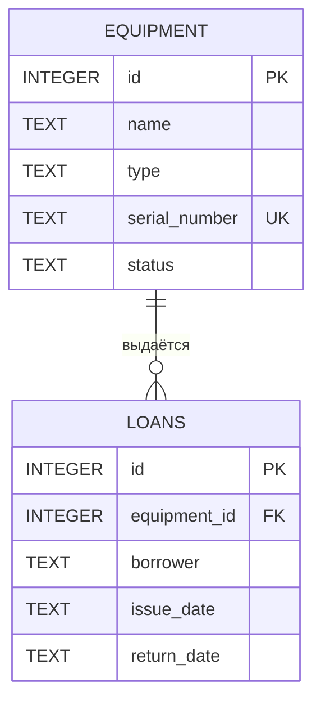

# ER-диаграмма

Одна единица оборудования может иметь несколько выдач в истории. У каждой выдачи есть ровно одна единица оборудования. Если `return_date` пустая, выдача активна. Частичный уникальный индекс `one_active_loan` запрещает две активные выдачи одного оборудования.
